<p align="center">
  
</p>

<h1 align="center">Fretlight</h1>

<p align="center">
  <strong>Learn guitar step by step, with an app that listens to you play. Fully offline.</strong>
</p>

<p align="center">
  <a href="https://github.com/kinshuk8/guitar-buddy/releases"></a>
  
  
  
</p>

---

Fretlight takes you from your first chord to barre chords up the neck.
A path of short lessons covers strings and notes, open chords, chord
changes, strumming in time, reading tab and whole songs. The app listens
through the microphone and checks what you play. Stars, levels, a daily
streak and a chord workout built from your weakest chords keep practice
going. The everyday tools are here too: a tuner, a chord library you can
hear, a metronome, a note and chord identifier, and songs to play along
with.

Everything runs on the device. There is no account, no advertising, no
analytics and no network access. The microphone is only open while a
listening screen is visible, and audio is never recorded or stored.

<p align="center">
  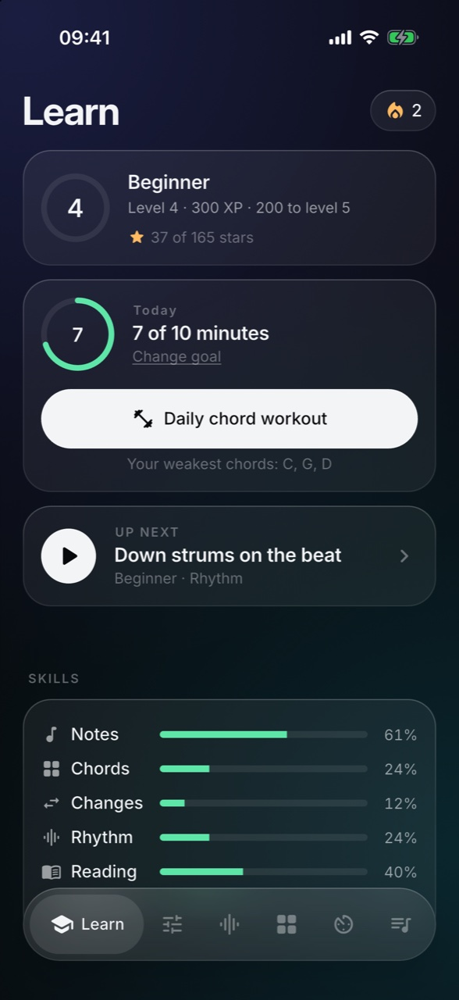
</p>

## Screens

<table>
  <tr>
    <td align="center">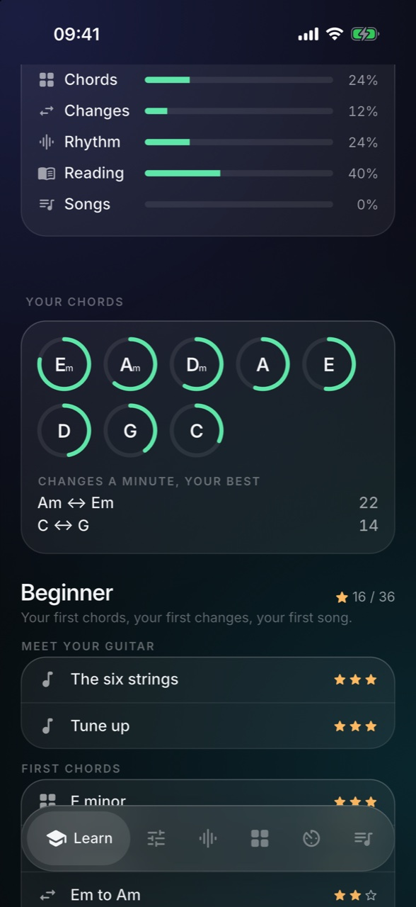<br><sub>Progress and chord mastery</sub></td>
    <td align="center">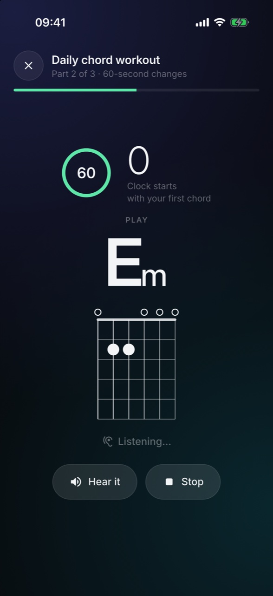<br><sub>One-minute changes</sub></td>
    <td align="center">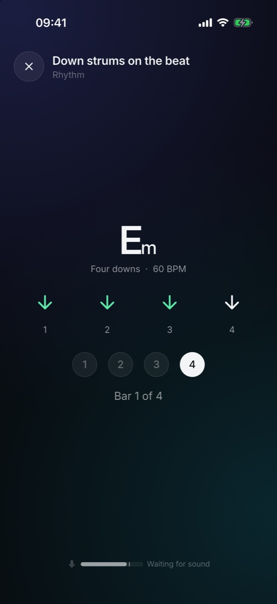<br><sub>Strum in time</sub></td>
  </tr>
  <tr>
    <td align="center">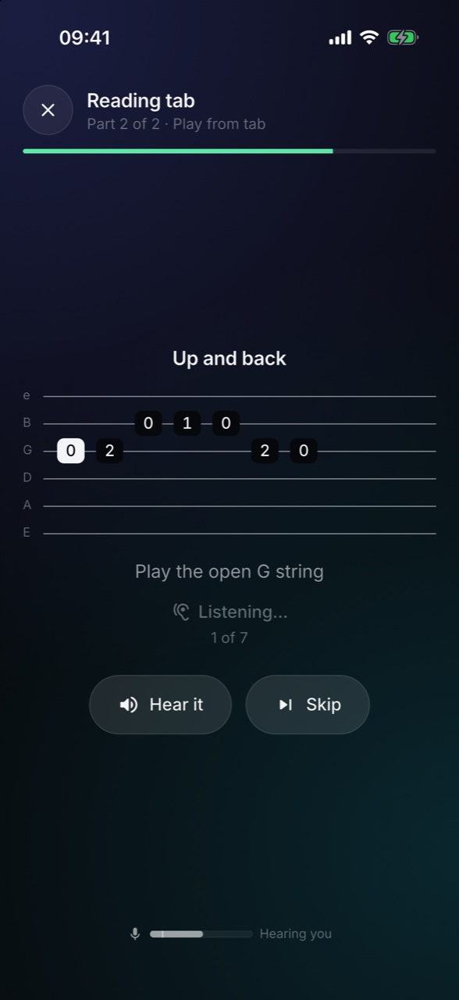<br><sub>Play from tab</sub></td>
    <td align="center"><br><sub>Tuner</sub></td>
    <td align="center">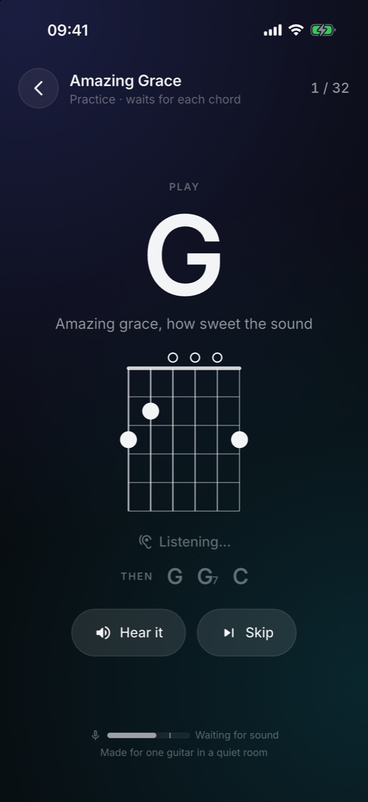<br><sub>Song practice</sub></td>
  </tr>
  <tr>
    <td align="center"><br><sub>Chord library</sub></td>
    <td align="center">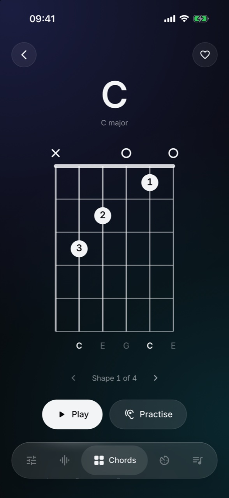<br><sub>Chord detail</sub></td>
    <td align="center">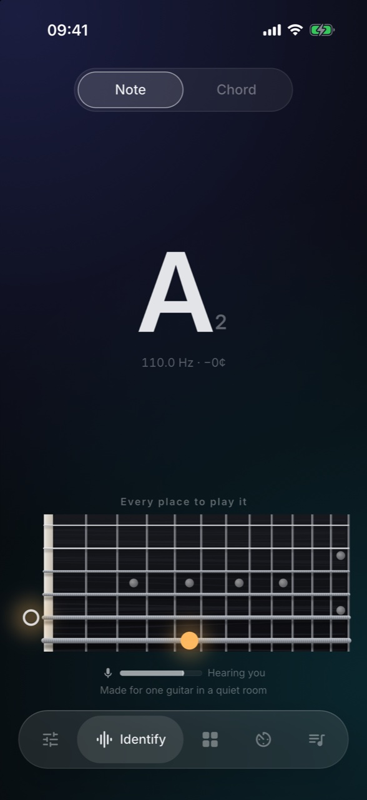<br><sub>Note identifier</sub></td>
  </tr>
  <tr>
    <td align="center">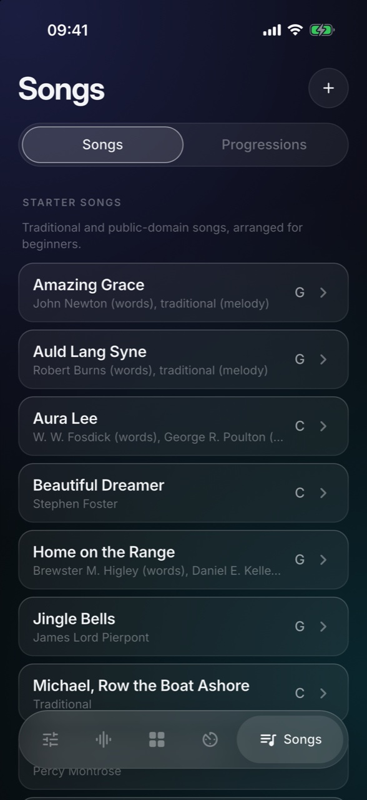<br><sub>Song library</sub></td>
    <td align="center">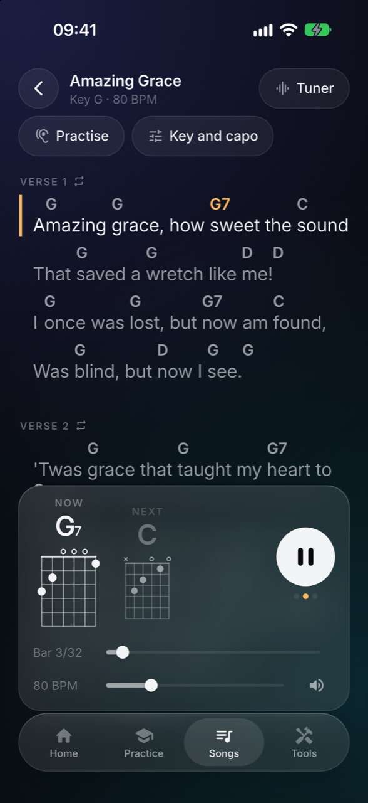<br><sub>Play-along</sub></td>
    <td align="center"><br><sub>Metronome</sub></td>
  </tr>
  <tr>
    <td align="center">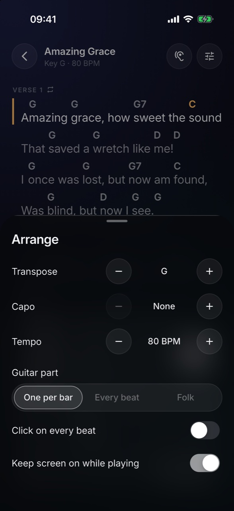<br><sub>Arrange a song</sub></td>
    <td align="center">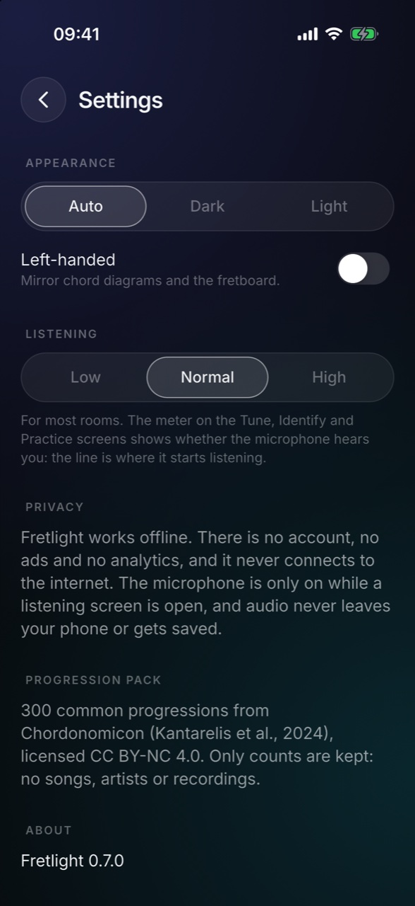<br><sub>Settings</sub></td>
  </tr>
</table>

## Features

**A path from first chord to mastery.** 55 short lessons in four stages:
Beginner, Improver, Adept and Mastery. You start with string names,
tuning, Em and Am, your first change, down-strums and a first song. Later
stages add every open chord, the folk strum, notes on the neck, reading
tab, the F and B minor barre chords, sevenths, I–IV–V in G, D, A, E and C,
and barre shapes up the neck. Lessons open in order, and you can start at
a later stage if you already play.

**Games that check what you play.** Chord drills and changes wait until
they hear the chord. One-minute change races count your clean changes, and
the app keeps your best for each pair. Strum-in-time lessons time every
strum against the beat. Note and tab lessons follow each note you play.
Quick quizzes on strings, notes, chord diagrams and tab need no guitar.

**Progress you can see.** Each lesson earns up to three stars. XP builds
levels, and six skill bars show where you are strong. There is a daily
practice goal and streak, and a mastery ring for every chord you have met.
The daily chord workout drills your two weakest chords and races you
between them.

**Tune quickly and accurately.** Pick a tuning, or let the tuner find the
string you play. It measures the string's fundamental, so a real steel
string reads true rather than a few cents sharp. Standard, drop D, DADGAD,
open G and half-step down are built in, alongside your own tunings and any
A4 reference.

**Learn chords by sight and sound.** Over 3,000 checked voicings, grouped
by root and type and searchable by name ("Am7", "G/B", "minor 7th"). Every
shape plays back as a strum, and you can tap a single string to hear it.
Draw your own shapes on a fretboard grid: the app names them from their
notes.

**Practise chord changes.** Drill one chord, or switch between two, and
the app moves on only when it hears the chord.

**Play along with songs.** Twelve public-domain starter songs, plus any
song you paste or import in [ChordPro](https://www.chordpro.org) format.
Press play to hear the guitar part at the song's tempo, slow it down, jump
to any bar, loop a section, transpose, or set a capo. The app suggests the
capo position that gives the easiest shapes.

**Practice mode that waits for you.** It shows the chord to play, listens,
and advances when you play it. Afterwards it lists the changes that
slowed you down.

**Identify what you hear.** Play a note to see its name and every place
it sits on the neck, or strum a chord to see its name.

**Keep time.** A sample-accurate metronome with time signatures,
subdivisions, per-beat accents and tap tempo.

**Works in real rooms.** Listening screens learn the room's background
level, so a fan or a quiet TV doesn't register as playing. A level meter
shows when the app hears you, and a sensitivity setting adjusts for
louder or quieter spaces.

**Built for everyone.** Light and dark themes, a left-handed mode, and
screen-reader labels throughout.

## Download

Android builds are published on the
[Releases page](https://github.com/kinshuk8/guitar-buddy/releases).

1. Open the latest release and download the APK for your device. The
   `universal` APK works on any phone; the `arm64-v8a` build is smaller
   and suits most current phones.
2. Open the file on your phone and allow installation from your browser or
   file manager when Android asks.
3. Grant microphone access the first time you open the tuner.

Requires Android 7.0 (API 24) or later. Releases are currently
pre-releases for testing. From 0.8.0 they are signed with the project's
release key; if you installed 0.7.0 or earlier, uninstall it first. iOS (15.0 or later)
builds from source; no App Store build is published yet.

## How it works

| Layer | Technology |
|---|---|
| UI | Flutter 3.47, Dart 3.13, custom glass design system |
| State and navigation | Riverpod 3, go_router |
| Storage | Drift (SQLite): settings, favourites, tunings, songs and chords |
| Audio input | `record` (PCM stream), `audio_session` |
| Audio output | `flutter_soloud`, scheduled on the audio engine's clock |
| Analysis | Pure-Dart DSP in a background isolate |

Analysis runs in a background isolate so the interface never waits on
it:

- **Pitch:** the McLeod Pitch Method finds the pitch, and a
  Blackman–Harris spectral measurement refines it onto the fundamental.
- **Chords:** a 16k-point FFT builds a chroma profile, which is matched
  against chord templates that model each note's harmonics, with
  bass-note and strum-onset tracking.
- **Strum timing:** a spectral-flux onset detector (SuperFlux-style) on
  5 ms hops finds each strum, even over strings that are still ringing.
  Timing is judged against your own average offset, so the phone's audio
  latency doesn't count against you.
- **Guitar sound:** the playback is synthesised on the device: a
  Karplus–Strong string tuned to a hundredth of a cent, with a
  pick-position excitation and an acoustic body filter.

Accuracy is measured in the test suite, not estimated. See
[docs/accuracy-report-m5.md](docs/accuracy-report-m5.md),
[docs/accuracy-report-m2.md](docs/accuracy-report-m2.md) and
[docs/metronome-timing.md](docs/metronome-timing.md).

```
lib/
  app/        shell and routing
  core/       design system, music theory, audio (DSP, synth, I/O), storage
  features/   learn, tuner, identify, chords, metronome, songs, practice, settings
              each split into domain / application / presentation
tool/         offline data converters and the icon renderer (never shipped)
docs/         design spikes, accuracy and data reports, screenshots
```

## Development

**Requirements:** Flutter 3.47 or later (Dart 3.13), Xcode for iOS, and
the Android SDK with JDK 17 for Android.

```bash
flutter pub get
flutter run
```

**Environment variables:** none. The app has no backend, API keys or
runtime configuration.

**Tests:**

```bash
flutter analyze
flutter test
```

The detector, tuner and metronome tests print their accuracy and drift
reports. To score the tuner against your own recordings, add WAV files to
`test/fixtures/wav/` (see the [README](test/fixtures/wav/README.md) there).

**Generated code and data:**

- **Drift database:** the generated code is committed. After editing
  `lib/core/storage/app_database.dart`, run
  `dart run build_runner build`.
- **Chord library:** `assets/chords/guitar.json` is converted from
  [chords-db](https://github.com/tombatossals/chords-db) with
  `dart run tool/chords_db/convert.dart <path-to-chords-db>`. The voicings
  it rejects are listed in
  [docs/chord-data-report.md](docs/chord-data-report.md).
- **Progression pack:** `assets/packs/chordonomicon/` holds 300 common
  chord loops aggregated from
  [Chordonomicon](https://huggingface.co/datasets/ailsntua/Chordonomicon)
  (CC BY-NC 4.0). Rebuild it with
  `dart run tool/chordonomicon/build_pack.dart <chordonomicon_v2.csv>`. To
  ship without it, delete the folder and its line in `pubspec.yaml`.
- **App icon:** the icon is drawn in code. Run
  `flutter test tool/icon/render_icon_test.dart`, then
  `tool/icon/install_icons.sh`.

**Songs:** the player assumes one chord per bar, because ChordPro has no
timing. Every bundled song was published before 1900 and cites its source
in a `{meta: source}` line, which the test suite checks.

## Roadmap

- A Google Play listing
- An App Store build for iOS
- Validation against real guitar recordings across more phones and rooms
- A final open-source licence for the code

## Contributing

Issues and pull requests are welcome. Before opening a pull request, run
`flutter analyze` and `flutter test`; both must pass. Keep the app
offline: no new dependency may make network calls at runtime. Any bundled
song must be in the public domain and cite its source.

## License

No open-source licence has been chosen yet, so the code is not currently
licensed for reuse. The bundled fonts, chord data, progression data and
packages each carry their own licences, listed in
[THIRD_PARTY_NOTICES.md](THIRD_PARTY_NOTICES.md). The progression data is
CC BY-NC 4.0, which allows non-commercial use only.
