<p align="center">
  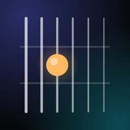
</p>

<h1 align="center">Fretlight</h1>

<p align="center">
  <strong>Learn guitar with an app that listens to you play.</strong><br>
  Lessons, a tuner, chords and songs. Fully offline, no account, no ads.
</p>

<p align="center">
  <a href="https://github.com/kinshuk8/guitar-buddy/releases/latest"></a>
</p>

<p align="center">
  <a href="https://github.com/kinshuk8/guitar-buddy/releases"></a>
  <a href="LICENSE"></a>
  
  
</p>

<p align="center">
  <a href="#download">Download</a> ·
  <a href="#screenshots">Screenshots</a> ·
  <a href="#features">Features</a> ·
  <a href="#privacy">Privacy</a> ·
  <a href="#build-from-source">Build from source</a>
</p>

<p align="center">
  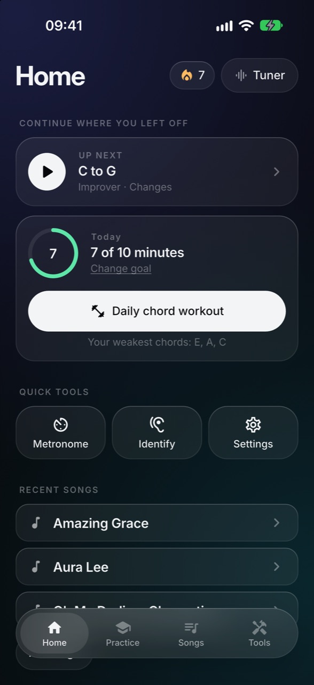
  &nbsp;
  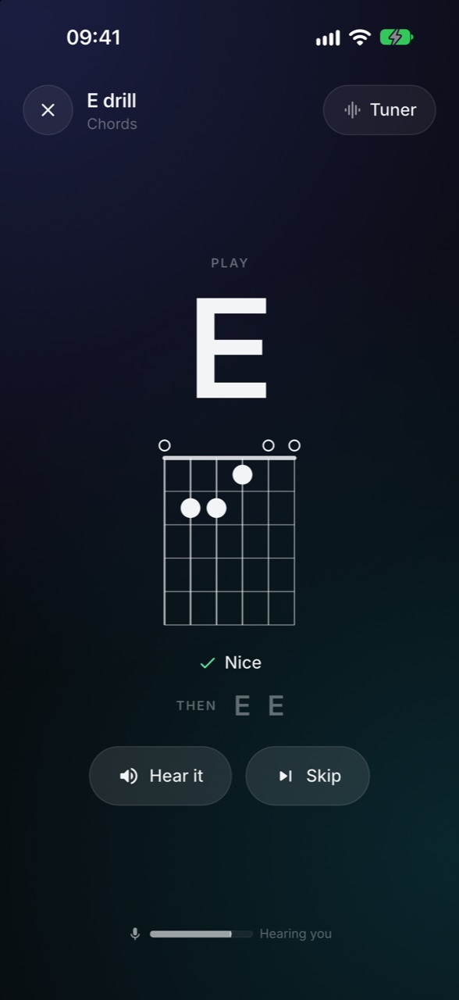
  &nbsp;
  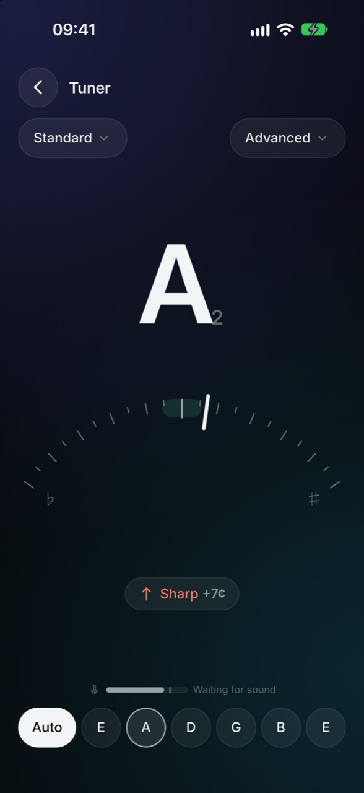
</p>

## Why Fretlight

- **It hears what you play.** Lessons and drills wait for the right chord, time your strums against the beat, and follow single notes. No tapping "done".
- **A path, not a pile of videos.** 55 short lessons take you from the names of the strings to barre chords up the neck, with stars, levels and a daily streak.
- **Built for your guitar.** Steel or nylon, new or old strings, a quiet room or a noisy one: listening adapts, and you choose how strictly chords are matched.
- **Everything else you need.** A tuner, a metronome, 3,000+ chord shapes you can hear, a chord and note identifier, and songs to play along with.
- **Private by design.** No account, no ads, no analytics. The Android app doesn't even ask for internet access.

## Screenshots

<table>
  <tr>
    <td align="center">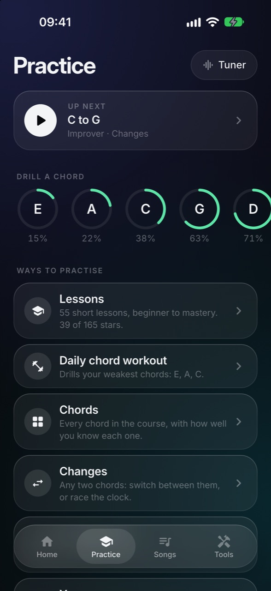<br><sub>Practice</sub></td>
    <td align="center">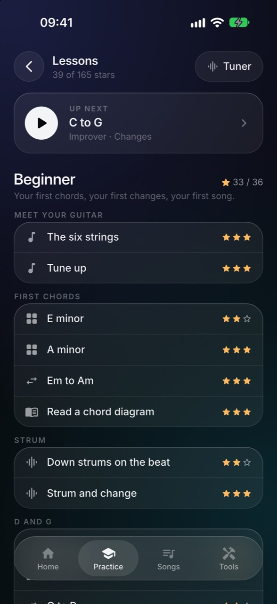<br><sub>Lessons</sub></td>
    <td align="center">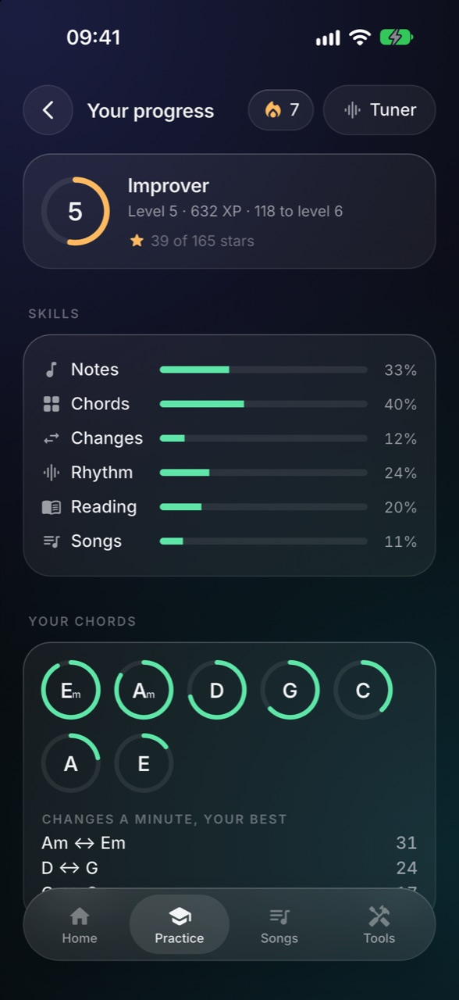<br><sub>Progress</sub></td>
  </tr>
  <tr>
    <td align="center">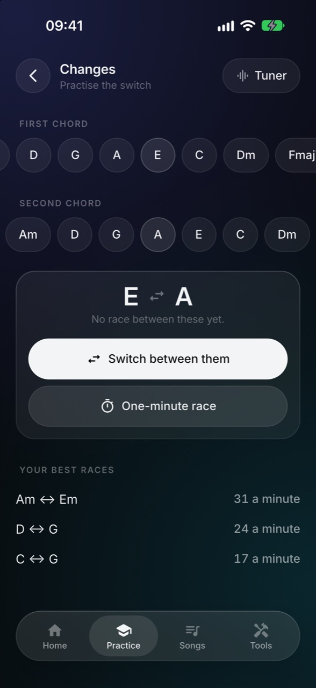<br><sub>Chord changes</sub></td>
    <td align="center">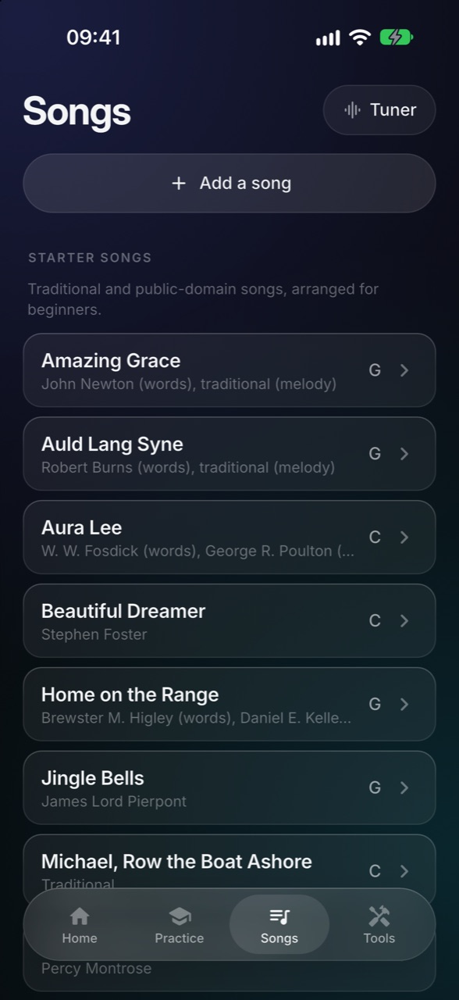<br><sub>Songs</sub></td>
    <td align="center"><br><sub>Play along</sub></td>
  </tr>
  <tr>
    <td align="center">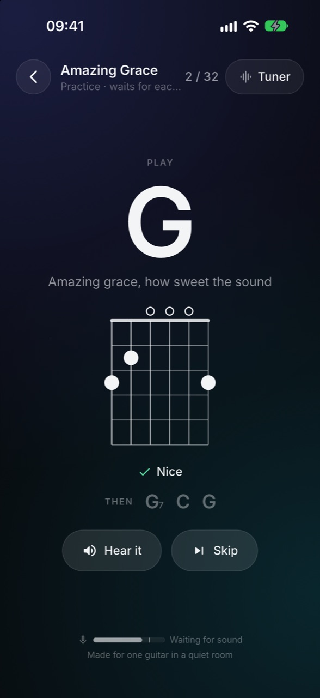<br><sub>Song practice</sub></td>
    <td align="center">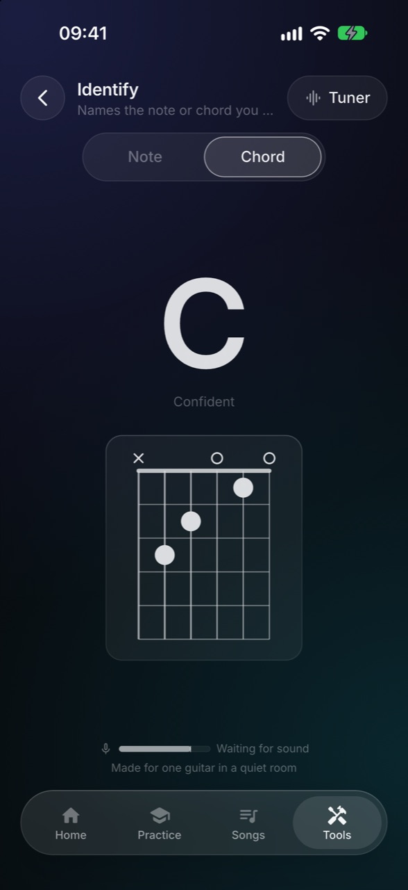<br><sub>Identify</sub></td>
    <td align="center">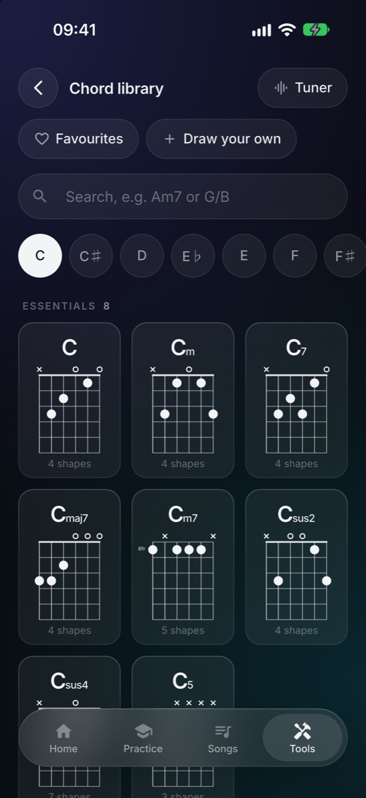<br><sub>Chord library</sub></td>
  </tr>
  <tr>
    <td align="center"><br><sub>Chord detail</sub></td>
    <td align="center">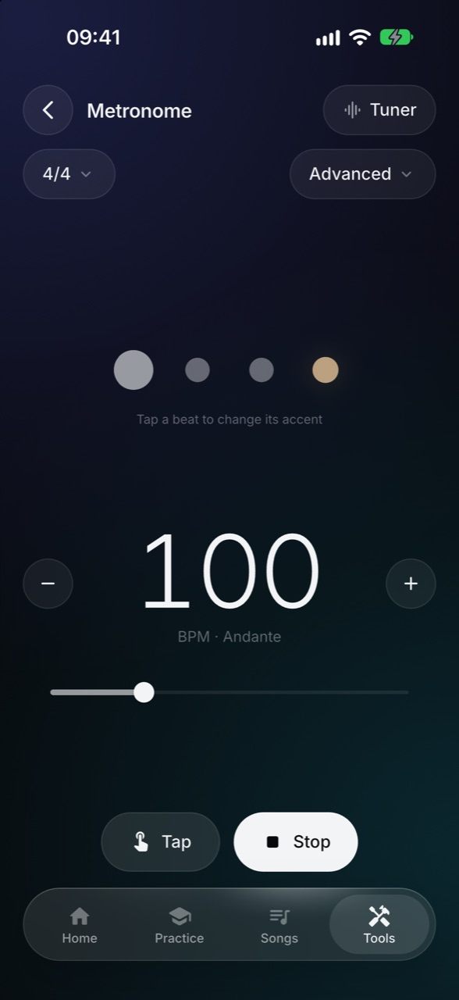<br><sub>Metronome</sub></td>
    <td align="center"><br><sub>Settings</sub></td>
  </tr>
</table>

Screenshots are from the iOS simulator running 0.10.1, with demo progress. On
listening screens the microphone was fed the app's own synthesised guitar.

## Features

**Learn**
- 55 lessons in four stages (Beginner, Improver, Adept, Mastery): strings and tuning, open chords, changes, strumming in time, notes on the neck, reading tab, barre chords, sevenths and the I–IV–V in five keys.
- Games that check what you play: chord drills, one-minute change races, strum-in-time, note and tab lessons, plus quick quizzes that need no guitar.
- Up to three stars a lesson, XP and levels, six skill bars, a daily goal and streak, and a mastery ring for every chord.
- A two-question welcome sets you up; new players go straight into a five-minute first session.

**Practise**
- Drill any chord: five clean strums, with a ring showing how well you know it.
- Pick any two chords to switch between, or race the clock and beat your best.
- A daily chord workout built from your weakest chords.
- Free practice counts toward your goal, streak and mastery, just like lessons.

**Play songs**
- Twelve public-domain starter songs, plus any song you paste or import as [ChordPro](https://www.chordpro.org).
- Hear the guitar part at the song's tempo; slow it down, loop a section, transpose, or set a capo (the app suggests the easiest one).
- Practice mode shows each chord, waits until you play it, and afterwards lists the changes that slowed you down.

**Tools**
- Tuner with auto string detection, standard and alternate tunings, your own tunings and any A4 reference.
- Chord library: over 3,000 checked shapes, searchable ("Am7", "G/B"), each one playable; draw your own and the app names it.
- Identify: play a note to see every place it sits on the neck, or strum a chord to see its name.
- Metronome with time signatures, subdivisions, per-beat accents and tap tempo.

**Listening that works on your guitar**
- Learns your room's background level, so a fan or a quiet TV doesn't count as playing.
- Tells the notes you play from their overtones, so a bright steel-string's E and Em are judged correctly.
- Chord matching (Exact, Normal or Forgiving) sets how strictly a strum must match. A wrong chord with its third clearly ringing (Em for E) never counts.

**For everyone**
- Light and dark themes, left-handed mode, and screen-reader labels throughout.

## Privacy

Fretlight runs entirely on your device. There is no account, no advertising,
no analytics and no network access: on Android the only permission it asks
for is the microphone. The microphone is open only while a listening screen
is visible, and audio is analysed as it arrives; it is never recorded or
stored. Your progress, songs and settings stay on the phone.

## Download

1. Open the [latest release](https://github.com/kinshuk8/guitar-buddy/releases/latest) and download an APK. `arm64-v8a` suits most current phones; `universal` works on any.
2. Open the file on your phone and allow installation from your browser or file manager when Android asks.
3. Allow microphone access when the app first listens.

Requires Android 7.0 or later. Releases are pre-releases for testing, signed
with the project's release key since 0.8.0 (uninstall 0.7.0 or earlier
first). Each release lists SHA-256 checksums. iOS (15.0 or later) builds
from source; there is no App Store build yet.

## How it works

| Layer | Technology |
|---|---|
| UI | Flutter 3.50, Dart 3.14, custom glass design system |
| State and navigation | Riverpod 3, go_router |
| Storage | Drift (SQLite): settings, favourites, tunings, songs and chords |
| Audio input | `record` (PCM stream), `audio_session` |
| Audio output | `flutter_soloud`, scheduled on the audio engine's clock |
| Analysis | Pure-Dart DSP in a background isolate |

Analysis runs in a background isolate so the interface never waits on
it:

- **Pitch:** the McLeod Pitch Method finds the pitch, and a
  Blackman–Harris spectral measurement refines it onto the fundamental.
- **Chords:** a 16k-point FFT builds a chroma profile, which is matched
  against chord templates that model each note's harmonics, with
  bass-note and strum-onset tracking.
- **Strum timing:** a spectral-flux onset detector (SuperFlux-style) on
  5 ms hops finds each strum, even over strings that are still ringing.
  Timing is judged against your own average offset, so the phone's audio
  latency doesn't count against you.
- **Guitar sound:** the playback is synthesised on the device: a
  Karplus–Strong string tuned to a hundredth of a cent, with a
  pick-position excitation and an acoustic body filter.

Accuracy is measured in the test suite, not estimated. See
[docs/accuracy-report-m5.md](docs/accuracy-report-m5.md),
[docs/accuracy-report-m2.md](docs/accuracy-report-m2.md) and
[docs/metronome-timing.md](docs/metronome-timing.md).

```
lib/
  app/        shell and routing
  core/       design system, music theory, audio (DSP, synth, I/O), storage
  features/   learn, tuner, identify, chords, metronome, songs, practice, settings
              each split into domain / application / presentation
tool/         offline data converters and the icon renderer (never shipped)
docs/         design spikes, accuracy and data reports, screenshots
```

## Build from source

**Requirements:** Flutter 3.50 or later (Dart 3.14), Xcode for iOS, and
the Android SDK with JDK 17 for Android.

```bash
flutter pub get
flutter run
```

**Environment variables:** none. The app has no backend, API keys or
runtime configuration.

**Tests:**

```bash
flutter analyze
flutter test
```

The detector, tuner and metronome tests print their accuracy and drift
reports. To score the tuner against your own recordings, add WAV files to
`test/fixtures/wav/` (see the [README](test/fixtures/wav/README.md) there).

**Generated code and data:**

- **Drift database:** the generated code is committed. After editing
  `lib/core/storage/app_database.dart`, run
  `dart run build_runner build`.
- **Chord library:** `assets/chords/guitar.json` is converted from
  [chords-db](https://github.com/tombatossals/chords-db) with
  `dart run tool/chords_db/convert.dart <path-to-chords-db>`. The voicings
  it rejects are listed in
  [docs/chord-data-report.md](docs/chord-data-report.md).
- **Progression pack:** `assets/packs/chordonomicon/` holds 300 common
  chord loops aggregated from
  [Chordonomicon](https://huggingface.co/datasets/ailsntua/Chordonomicon)
  (CC BY-NC 4.0). Rebuild it with
  `dart run tool/chordonomicon/build_pack.dart <chordonomicon_v2.csv>`. To
  ship without it, delete the folder and its line in `pubspec.yaml`.
- **App icon:** the icon is drawn in code. Run
  `flutter test tool/icon/render_icon_test.dart`, then
  `tool/icon/install_icons.sh`.

**Songs:** the player assumes one chord per bar, because ChordPro has no
timing. Every bundled song was published before 1900 and cites its source
in a `{meta: source}` line, which the test suite checks.

## Roadmap

- A Google Play listing
- An App Store build for iOS
- Validation against real guitar recordings across more phones and rooms

## Contributing

Issues and pull requests are welcome. Before opening a pull request, run
`flutter analyze` and `flutter test`; both must pass. Keep the app
offline: no new dependency may make network calls at runtime. Any bundled
song must be in the public domain and cite its source.

To refresh the screenshots, boot an iOS simulator and run
`tool/screenshots.sh`.

## Licence

Fretlight is free software under the [GNU General Public License v3.0](LICENSE):
you may use, study, share and change it, and anything you distribute that is
built from it must be released under the same licence.

The bundled fonts, chord data, progression data and packages keep their own
licences, listed in [THIRD_PARTY_NOTICES.md](THIRD_PARTY_NOTICES.md). The
progression data is CC BY-NC 4.0, which allows non-commercial use only.
